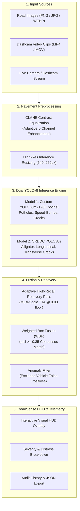

<div align="center">

# 🛣️ RoadSense: AI-Powered Road Anomaly & Pothole Detection

**Dual-pipeline YOLOv8 neural network for real-time pavement distress inspection, pothole localization, and road hazard telemetry.**

[](https://www.python.org/)
[](https://github.com/ultralytics/ultralytics)
[](https://pytorch.org/)
[](https://react.dev/)
[](https://www.typescriptlang.org/)
[](https://vitejs.dev/)
[](https://tailwindcss.com/)
[](LICENSE)

[Live Features](#-key-features) • [Architecture](#-dual-model-architecture) • [Dataset & Metrics](#-dataset--benchmark-metrics) • [Quick Start](#-quick-start-guide) • [API Reference](#-backend-api-reference)

---

</div>

## 📖 Overview

**RoadSense** is an end-to-end computer vision and infrastructure auditing platform engineered to detect, segment, and categorize roadway surface anomalies. By pairing a custom **YOLOv8m** network trained on over 30,000 real-world pavement images with a specialized **YOLOv8s** crack morphology model, RoadSense achieves high-accuracy anomaly localization across challenging real-world dashcam perspectives.

The platform provides a modern, responsive web application for automated photo/video defect inspections, real-time camera HUD tracking, severity analytics, and audit history.

---

## ⚡ Key Features

* **Dual-Model Neural Ensemble**:
  * **Model 1 (Custom YOLOv8m)**: Fine-tuned over 120 epochs on 30,685 multi-source roadway images for macro road distress (*Potholes, Speed Bumps, Severe Cracks, Pedestrians*).
  * **Model 2 (CRDDC YOLOv8s)**: Specialized in micro surface crack classification (*Longitudinal, Transverse, and Alligator Cracking*).
  * **Consensus Fusion**: Combines overlapping predictions via Weighted Box Fusion (WBF) with boosted confidence scoring.
* **Surface Pavement Contrast Equalization (CLAHE)**:
  * Enhances luminance channels to expose hairline micro-cracks and shadow-obscured potholes without blowing out highlights.
* **Adaptive High-Recall Recovery**:
  * Multi-scale test-time recovery pass (down to 3% confidence floor) ensuring subtle speed breakers or low-light road depressions are never missed.
* **Interactive HUD & Model Render**:
  * Toggle between SVG/Canvas interactive bounding box overlays and high-resolution OpenCV annotated imagery.
* **Real-Time Dashcam & Live Stream HUD**:
  * Browser-based video frame analyzer and live camera streaming HUD operating at 25–35 FPS.
* **Dynamic Confidence & Class Filtering**:
  * Precision/Recall threshold tuning (1% Max Recall to 90% Precision) with road-anomaly-specific class filtering.
* **Telemetry & Severity Scoring**:
  * Automated pavement risk calculation (*Low, Medium, High*) based on defect density and severe cavity weights.
* **Exportable Reports & Audit History**:
  * Full inspection session logging, summary clipboard copy, and exportable JSON telemetry reports.

---

## 🧠 Dual-Model Architecture



---

## 📊 Dataset & Benchmark Metrics

### Training Dataset (30,685 Images)
The primary detection network was trained and evaluated on a unified multi-source dataset combining:
* **RAD Dataset**: ~8,400 images
* **Indian Roads Dataset**: ~5,100 images
* **Humps / Bumps / Potholes**: ~3,200 images
* **HighRPD Dataset**: ~11,700 images

### Test Set Benchmark Performance (Model 1 — Unseen Roadways)

| Anomaly Class | Precision | Recall | mAP@0.5 | mAP@0.5:0.95 |
| :--- | :---: | :---: | :---: | :---: |
| **Overall Dataset** | **0.736** | **0.740** | **0.745** | **0.448** |
| **Speed-Bump** | 0.804 | 0.908 | **0.885** | 0.487 |
| **Crack** | 0.576 | 0.484 | **0.505** | 0.240 |
| **Crack-Severe** | 0.548 | 0.503 | **0.493** | 0.273 |
| **Pothole** | 0.597 | 0.440 | **0.468** | 0.198 |
| **Pedestrian** | 0.822 | 0.915 | **0.918** | 0.522 |

*Average Inference Latency: **~12 ms per image** on NVIDIA RTX 3060 GPU.*

---

## 🚀 Quick Start Guide

### Prerequisites
* **Node.js**: v18.0 or higher
* **Python**: v3.10 or higher
* **Git**

---

### 1. Clone the Repository
```bash
git clone https://github.com/aaronalphons14/Pothole-detection.git
cd Pothole-detection
```

---

### 2. Backend Setup (Flask + YOLOv8)

1. Create and activate a Python virtual environment:
   ```bash
   # Windows (PowerShell)
   python -m venv .venv
   .venv\Scripts\Activate.ps1

   # Linux / macOS
   python3 -m venv .venv
   source .venv/bin/activate
   ```

2. Install backend dependencies:
   ```bash
   pip install ultralytics supervision opencv-python flask flask-cors numpy
   ```

3. Launch the API server:
   ```bash
   python backend_server.py
   ```
   *The server starts on `http://localhost:5000` and automatically loads Model 1 (`best.pt`) and Model 2 (`YOLOv8_Small_2nd_Model.pt`).*

---

### 3. Frontend Setup (React + Vite)

1. Open a new terminal window in the project root:
   ```bash
   npm install
   ```

2. Verify environment configuration:
   A default `.env.example` is provided. If not already present, create a `.env` file:
   ```env
   VITE_API_URL=http://localhost:5000
   ```

3. Run the development server:
   ```bash
   npm run dev
   ```
   *Open [http://localhost:3000](http://localhost:3000) in your browser.*

---

## 🔌 Backend API Reference

### `GET /health`
Verifies backend status and model availability.

**Response:**
```json
{
  "status": "ok",
  "model1_loaded": true,
  "model2_loaded": true,
  "model1_name": "YOLOv8m Custom 120 Epochs",
  "model2_name": "YOLOv8s CRDDC Damage Model"
}
```

---

### `POST /detect`
Performs dual-pipeline inference on an uploaded image or video clip.

**Form Parameters:**
* `file`: The media file (image or video).
* `model`: Model selection (`"m1"`, `"m2"`, or `"both"`).
* `conf_m1`: Model 1 confidence threshold (`0.01` – `0.95`, default: `0.25`).
* `conf_m2`: Model 2 confidence threshold (`0.01` – `0.95`, default: `0.25`).

**Sample JSON Response:**
```json
{
  "success": true,
  "inference_ms": 14.8,
  "image_width": 1280,
  "image_height": 720,
  "original_url": "http://localhost:5000/static/uploads/sample.jpg",
  "result_url": "http://localhost:5000/static/results/result_sample.jpg",
  "counts": {
    "potholes": 2,
    "cracks": 1,
    "bumps": 0,
    "total": 3
  },
  "detections": [
    {
      "id": 1,
      "model": "m1",
      "class": "Pothole",
      "confidence": 0.872,
      "box": [0.312, 0.445, 0.582, 0.691]
    }
  ]
}
```

---

## 📁 Repository Structure

```tree
Pothole-detection/
├── backend_server.py           # Flask REST API + Dual YOLOv8 Inference Engine
├── package.json                # Frontend package dependencies & scripts
├── vite.config.ts              # Vite + TanStack build configuration
├── tsconfig.json               # TypeScript project settings
├── .env.example                # API URL environment template
├── public/                     # Static charts, sample assets, and icons
├── src/                        # Modern React 19 Frontend Application
│   ├── assets/                 # Sample defect images (pothole, crack, bump)
│   ├── components/             # Reusable UI & BoxOverlay HUD components
│   ├── lib/
│   │   ├── api.ts              # Backend API bridge & response mapper
│   │   ├── classes.ts          # Road defect definitions & theme tokens
│   │   ├── detection-store.ts  # Session storage & audit history
│   │   └── mock.ts             # Performance benchmarks & fallback metrics
│   └── routes/                 # TanStack filesystem routes
│       ├── index.tsx           # Landing hero & feature showcase
│       ├── detect.tsx          # Upload, settings & scanner workspace
│       ├── results.tsx         # Interactive inspection HUD & telemetry
│       ├── performance.tsx     # Precision-Recall & dataset analytics
│       ├── live.tsx            # Real-time webcam / dashcam HUD
│       ├── history.tsx         # Audit trail & past inspections
│       └── about.tsx           # Architecture and methodology
├── road-anomaly-detection-main/
│   └── road-anomaly-detection-main/
│       ├── RoadDetectionModel/ # Custom YOLOv8m weights (best.pt) & curves
│       ├── YOLOv8_Small_2nd_Model.pt # Pre-trained CRDDC model weights
│       ├── train.ipynb         # Model training & evaluation notebook
│       └── main.py             # Streamlit baseline demo application
└── static/                     # Backend uploaded & result-rendered images
```

---

## 🛠️ Tech Stack

* **Machine Learning**: [YOLOv8 (Ultralytics)](https://github.com/ultralytics/ultralytics), [Supervision (Roboflow)](https://github.com/roboflow/supervision), [PyTorch](https://pytorch.org/), [OpenCV](https://opencv.org/)
* **Backend API**: [Flask](https://flask.palletsprojects.com/), [Flask-CORS](https://flask-cors.readthedocs.io/)
* **Frontend Web App**: [React 19](https://react.dev/), [TypeScript](https://www.typescriptlang.org/), [Vite](https://vitejs.dev/), [TanStack Router](https://tanstack.com/router), [Tailwind CSS v4](https://tailwindcss.com/), [Framer Motion](https://www.framer.com/motion/), [Lucide Icons](https://lucide.dev/)

---

## 📄 License

This project is licensed under the [MIT License](LICENSE).
